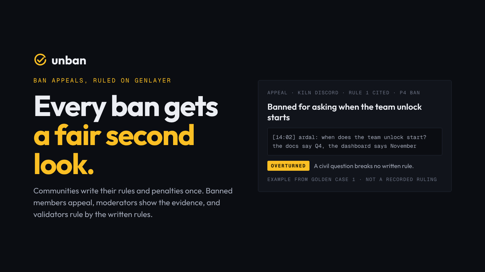

# Unban

**Ban appeals, decided by the community's own rules.** An appeals court for Discord, Telegram and X communities on GenLayer
Studio Next: a community writes its rules and a penalty ladder once, a banned member appeals with a small fee, a moderator
answers with the rule broken and the quoted evidence, and GenLayer validators decide from the written rules alone whether the
ban is **upheld**, **reduced** to the penalty the ladder sets, or **overturned**. A ban nobody answers in time is **defaulted**
to the member. A read-only bot applies the ruling.



## Status

| | |
| --- | --- |
| Contract | `contracts/unban.py`, 12 public methods, lint and validation passed against GenVM v0.6.0-rc6 |
| Direct tests | 64 passed (`python -m pytest tests -q`) |
| Mutations | 32 defences broken one at a time, all caught (`tests/MUTATIONS.md`) |
| Golden set | 9 cases + 3 held out, sealed before any run (`eval/golden.sha256`) |
| Site and docs | `web/`, `npm run build` passes, checked at desktop and phone width |
| Bot | `bot/`, 3 tests pass |
| Deployment, golden run, walk | **not run yet** (rechecked 2026-10-19): the build environment cannot reach Studio Next. See [HANDOFF.md](HANDOFF.md) |
| Repository | its own: `github.com/meitipro/genlayer-unban` (to be created by the owner, see [HANDOFF.md](HANDOFF.md)) |
| Live site | **not deployed yet**: the Vercel connection may not create the `use-unban` project. See [HANDOFF.md](HANDOFF.md) |

No address, transaction hash or verdict appears anywhere in this repository until a script has read it from the chain.

## How it works

| Step | Who | Method |
| --- | --- | --- |
| Rules | community owner | `open_court(name, rules, ladder, mods, appeal_fee, compensation, response_hours)`, payable: first pool funding |
| Appeal | banned member | `appeal(court_id, case_ref, statement)`, payable: exactly the fee; reserves one compensation from the pool |
| Evidence | listed moderator | `respond(appeal_id, rule, level, evidence)` within the window (12 to 96 h) |
| Reply | the member, once | `reply(appeal_id, text)` within 24 h |
| Ruling | anyone | `judge(appeal_id)` after the reply or the reply window; `default(appeal_id)` if nobody answered |
| Money | member, owner | `withdraw()`: the only call that pays, a top-level transfer |

Also `update_court` (owner only, refused while appeals are open, applies to bans dated after it), `fund`, and the views
`get_court`, `get_appeal`, `list_appeals`.

| Ruling | Money | The bot |
| --- | --- | --- |
| OVERTURNED | fee back plus compensation | lifts the ban |
| REDUCED · P*n* | fee back | replaces the ban with P*n* |
| UPHELD | fee to the pool | ban stays |
| DEFAULTED | fee back plus compensation | lifts the ban |

## The judge

The prompt in section 3 of the spec is the `JUDGE` constant, word for word. Every caller string is fenced (`<` and `>` become
`(` and `)`), so nobody can close a `<<< >>>` block. Validators run the prompt themselves and agree only when the **verdict
and the level** match; the reason sentence is the leader's and never compared. The normaliser refuses a REDUCED level that is
not on the ladder or not lighter than the level applied. A model failure gets one retry inside the block and is never agreed
with, so a round rotates rather than storing a guess.

## Studio Next lessons built in

- Runtime header `py-genlayer:5jycge4q…`, `gl.contract.Contract`, `gl.message.raw`, `gl.vm.run_nondet`, copied from the Recourse port.
- Money moves only in `withdraw`, the root of its transaction; the site and scripts add the External fee allocation a payout needs.
- Fee deposits from Studio's estimate on every write; a flat 600 time-unit allocation when Studio cannot simulate the call.
- A write counts as successful only when accepted **and** returned; otherwise the contract's sentence is shown.
- Windows run on `gl.message.raw["datetime"]`; text only, no web reads, so every validator sees the same input.
- Reads are cached for 15 s under one tag that a write drops (the RPC is a shared budget).

## Layout

```
contracts/unban.py         the contract, judge prompt pinned inside
tests/test_direct.py       every method and rule, model mocked; tests/double is the genlayer test double
eval/golden.json           golden + held-out cases, sealed in golden.sha256; eval/run_golden.py runs them
scripts/chain.py           Studio Next client (fees, payouts, success test, nonce-guarded writes)
scripts/deploy.py  seed.py  walk.py  verify_source.py  mutate.py
bot/                       read-only Discord bot: polls list_appeals, holds no wallet key
web/                       Next.js site and Fumadocs docs at /docs
submission/                portal text, demo script, 512 px logo, cover
```

## Run it

```bash
# contract
pip install -r requirements.txt
python -m pytest tests -q
GENVM_VERSION=v0.6.0-rc6 genvm-lint check contracts/unban.py
python scripts/mutate.py

# chain (needs Studio Next reachable)
python scripts/deploy.py && python eval/run_golden.py && python scripts/walk.py && python scripts/seed.py

# site
cd web && npm install && npm run dev

# bot
cd bot && npm install && UNBAN_COURT=1 DISCORD_TOKEN=... DISCORD_GUILD=... npm start
```

## Honest limits

Unban decides whether the record shows a written rule broken and whether the penalty fits the ladder, not what really happened
in the chat. It trusts the quoted evidence unless the record contradicts itself, it covers a community's own rules rather than
platform terms, and it only works as well as the rules a community is willing to write down.
